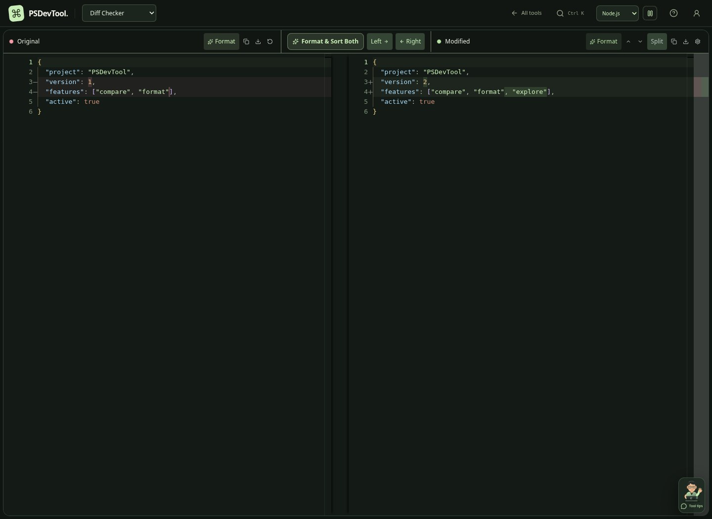
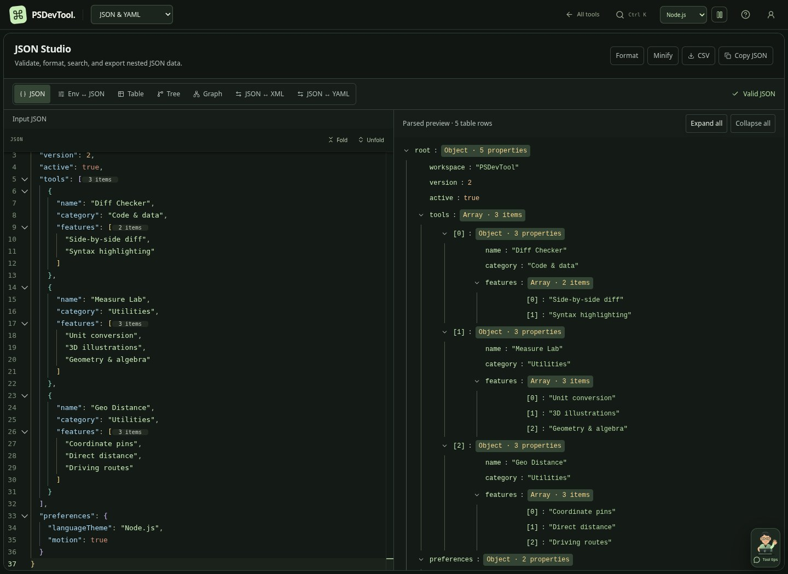
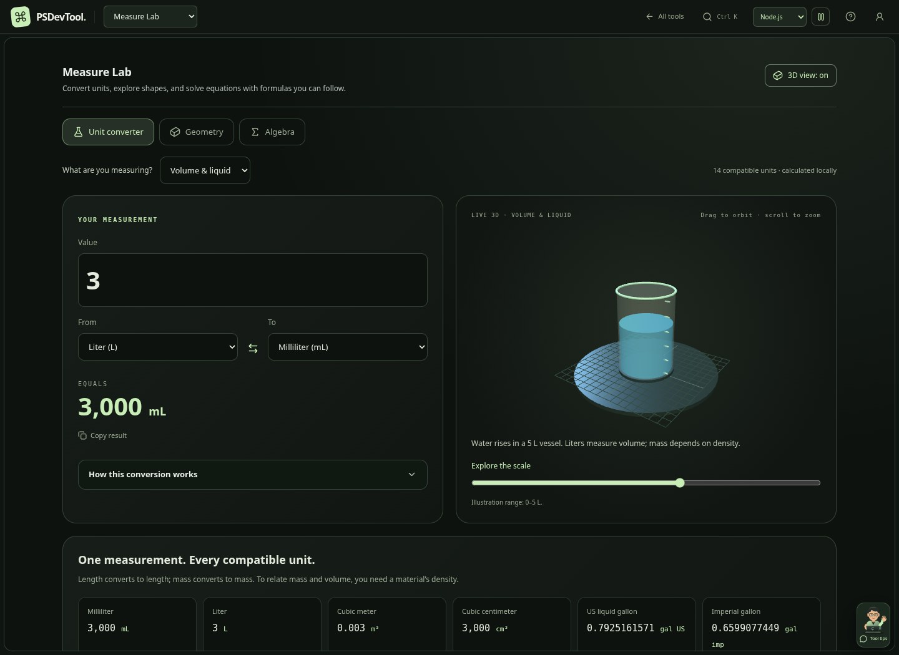
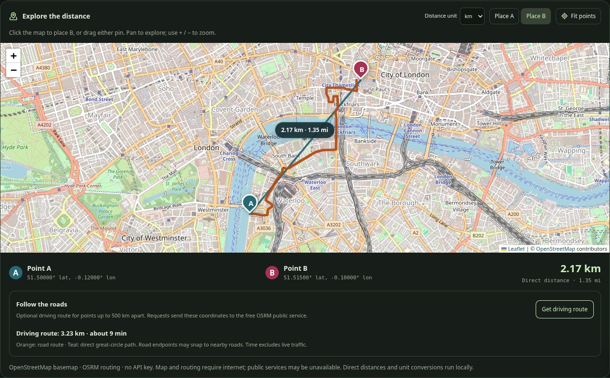
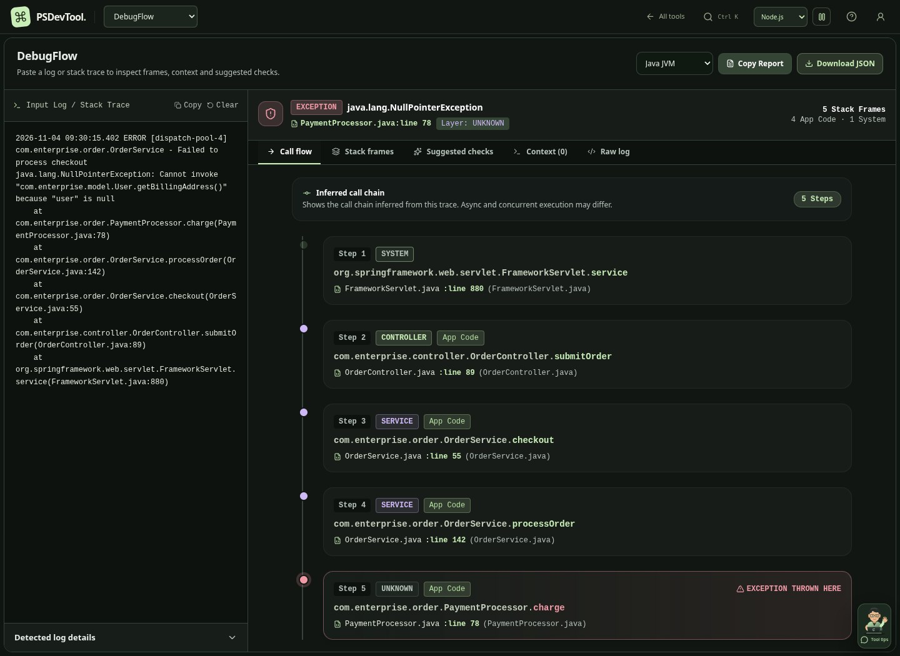
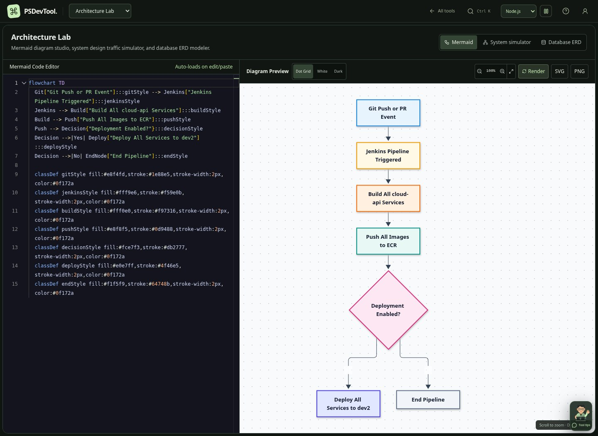

# PSDevTool

**A developer workspace for comparing code, inspecting data, debugging requests, and making measurements tangible.**

[Open PSDevTool](https://psdevtool.online/) · [Explore the tools](#tools) · [Screenshots](#screenshots) · [Run locally](#run-locally)

PSDevTool brings 19 tools into one React and TypeScript application. Compare text and files, work with JSON/XML/YAML, inspect network data, create diagrams, process documents and images, and explore unit conversions with interactive 3D illustrations.

All 19 tools are visible in the catalog, grouped by task. A compact tool picker, recent-tool shortcuts, and keyboard search keep navigation close at hand. Choose a Node.js, Python, TypeScript, Go, or Rust theme; your theme and motion preference are remembered in your browser.



## Tools

### Code and data

| Tool | What you can do |
| --- | --- |
| **Diff Checker** | Compare text side by side, inspect changes, format structured input, and adjust comparison settings. |
| **File & Folder Diff** | Compare local files and folder contents, then inspect individual differences. |
| **JSON & YAML** | Format and validate JSON; explore tree, table and graph views; convert JSON ↔ XML/YAML and environment text ↔ JSON. Fold nested code and see array lengths without changing the source. |
| **Regex Lab** | Test patterns against text, highlight matches, inspect capture groups, and start from presets. |
| **Markup Studio** | Preview HTML and Markdown, format XML and SQL, and inspect the output. |

### Network and debugging

| Tool | What you can do |
| --- | --- |
| **API Desk** | Build HTTP requests, inspect responses, and work with cURL and API specifications. Requests run from your browser and follow its CORS rules. |
| **HAR Viewer** | Inspect HTTP archives, request timing, headers, payloads, and network waterfalls. |
| **JWT Debugger** | Decode headers and claims, inspect expiry, and check supported HMAC signatures locally. Decoding alone does not verify a token. |
| **DebugFlow** | Parse supported logs and stack traces, inspect frames and context, and export a report. Built-in examples cover C#/.NET, Java, Python, and Node.js. |

### Create and transform

| Tool | What you can do |
| --- | --- |
| **Architecture Lab** | Render Mermaid diagrams, build system-design simulations, and model database relationships. Simulator results describe the local model. |
| **PDF Studio** | Merge and split PDFs, convert images or documents to PDF, and use the available extraction and document-processing workflows. |
| **Image Studio** | Crop, resize, rotate, flip, compress, and convert images. |

### Everyday utilities

| Tool | What you can do |
| --- | --- |
| **Measure Lab** | Convert 119 units across 17 measurement categories, explore interactive 3D illustrations, calculate 15 geometry shapes, and use six algebra tools with visible formulas. |
| **Geo Distance** | Place or drag latitude/longitude pins, compare direct and optional driving-route distances, and convert distance units. Also includes batch pairs, bearings and geofence calculations. |
| **ID Generator** | Generate UUIDs and other supported identifier formats. |
| **Time Zones** | Convert Unix timestamps and compare times across zones. |
| **Image Base64** | Encode images into data URLs or decode Base64 image data. |
| **Case Converter** | Convert text between common prose and programming naming styles. |
| **URL Tools** | Encode/decode URLs and inspect query parameters. |

Press **Ctrl+K** or **⌘K** to find a tool by name, format, or task. Search supports arrow keys, Enter, and Escape. Use the help button for the current tool’s workflow and network behavior. Tools load when first opened and retain their inputs while switching within the workspace; reloading or leaving the workspace may reset unsaved inputs. Advanced formulas and distance statistics expand on demand. Measure Lab’s 3D view can be hidden without losing calculations. Use the motion control beside the theme selector to pause effects. System reduced-motion preferences are respected.

## Screenshots

These are real captures of a local production build using sample data. Expand a tool to inspect its interface. The gallery focuses on the tools.

<details open>
<summary><strong>JSON Studio — syntax colors, code folding, array counts and a parsed tree</strong></summary>



</details>

<details>
<summary><strong>Measure Lab — unit conversion with a live 3D water vessel</strong></summary>



Length, mass, volume, area, temperature, time, speed, pressure, energy, power, angle, digital storage, frequency, force, density, current, and voltage each have an illustration. Convert within compatible dimensions: kilograms to grams, for example. Relating mass to volume requires density.

Geometry includes plane and solid shapes with applicable area, perimeter, surface-area and volume formulas. Algebra includes linear and quadratic equations, two-equation systems, percentages, and arithmetic/geometric sequences.

</details>

<details>
<summary><strong>Geo Distance — coordinate pins, direct distance and a driving route</strong></summary>



The map uses Leaflet and OpenStreetMap with visible attribution. For points up to 500 km apart, **Get driving route** requests a road path from the free OSRM public service. Direct and road distances stay separate; driving time excludes live traffic. No paid map API key is required.

</details>

<details>
<summary><strong>DebugFlow — a sample Java stack trace and parsed execution flow</strong></summary>



</details>

<details>
<summary><strong>Architecture Lab — Mermaid source and its rendered diagram</strong></summary>



</details>

## Run locally

Use Node.js **22.12+** or **24 LTS**, with npm. No application environment variables or paid API keys are required for local startup.

```sh
npm install
npm run dev
```

Open **http://localhost:3000**.

The repository also includes `bun.lock`. With Bun installed, you can use `bun install --frozen-lockfile` and `bun run dev` instead.

### Build and check calculations

```sh
npm run build
npm run test:measurements
npm run test:catalog
```

The build runs TypeScript checks and produces `dist/`. The measurement checks exercise conversions, geometry, algebra, coordinate-path edge cases, invalid inputs, and career-date boundaries. Catalog checks protect all 19 tool IDs, shared search metadata, and recent-history validation.

To serve the production build locally:

```sh
npm run preview -- --host 0.0.0.0 --port 4173
```

Open **http://localhost:4173**. Deploy `dist/` to a static host such as Vercel. Tool navigation uses hash routes such as `/#/json`, `/#/distance`, and `/#/measure`.

## How data and network access work

- Text/file comparisons, structured-data formatting, log parsing, unit conversions, geometry, algebra, and 3D rendering run in your browser. Local file processing does not require a PSDevTool upload service.
- **API Desk** contacts the endpoint you choose. Browser CORS restrictions apply. The optional corsproxy.io proxy forwards requests through that third-party service; spec loading no longer enables it automatically after a failure. Collections and request history are saved locally by API Desk.
- **Geo Distance** requests basemap tiles from OpenStreetMap. Clicking **Get driving route** sends the selected coordinates to OSRM. Public map/routing services require internet access and have no availability guarantee; direct-distance calculations remain local.
- Monaco and some document-processing resources can load from external CDNs. The hosted app also includes Google Analytics and advertising scripts, so the application is not completely offline or free of third-party network requests.
- Language theme, motion, tool favorites, recent tool IDs, and the Measure Lab 3D-view preference are stored locally in your browser. Recent-tool history stores IDs rather than input contents.

Numerical results use JavaScript floating-point arithmetic and are rounded for display. 3D measurement scenes are explanatory illustrations with stated ranges; their visual limits do not cap the conversion result. A WebGL-capable browser enables the 3D scenes; calculations and formulas remain available without WebGL.

## Built with

| Layer | Libraries |
| --- | --- |
| Application | React 19, TypeScript, Vite |
| Interface | Tailwind CSS, custom CSS, Lucide React |
| Editing and comparison | Monaco Editor, `diff`, Prettier, YAML, XML and SQL formatters |
| Diagrams and 3D | React Flow, Mermaid, Three.js |
| Maps and routing | Leaflet, OpenStreetMap tiles, OSRM public routing |
| Documents and images | `pdf-lib`, `docx-preview`, JSZip, `html-to-image` |

Technology-logo assets include source and license information in [public/technology](public/technology). Detailed implementation and validation notes are in [docs/3d-redesign.md](docs/3d-redesign.md).
