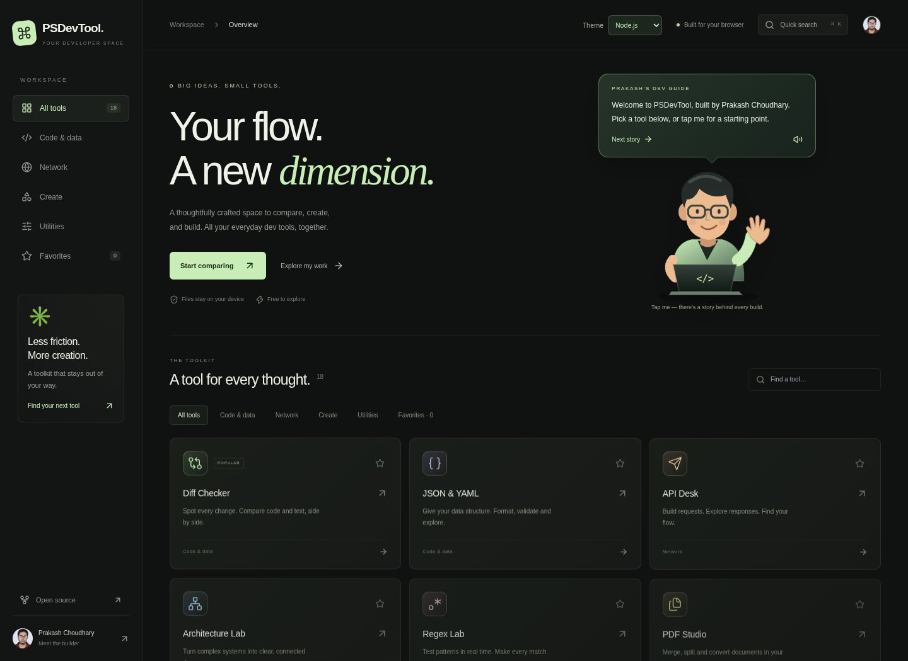
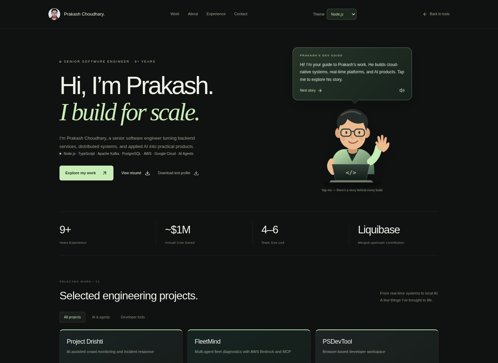
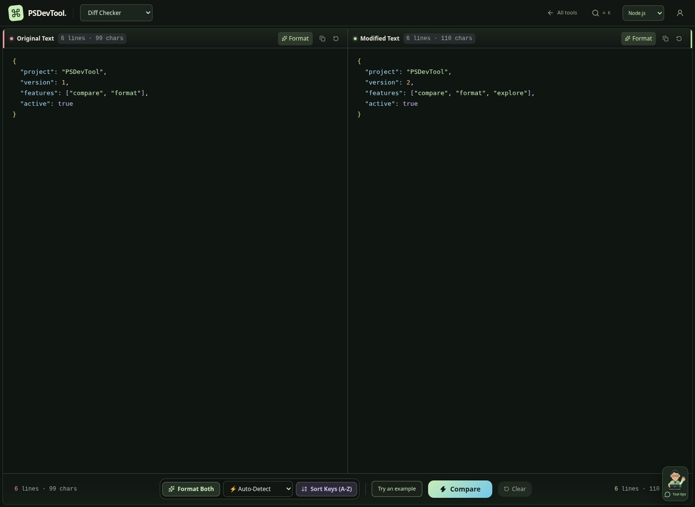
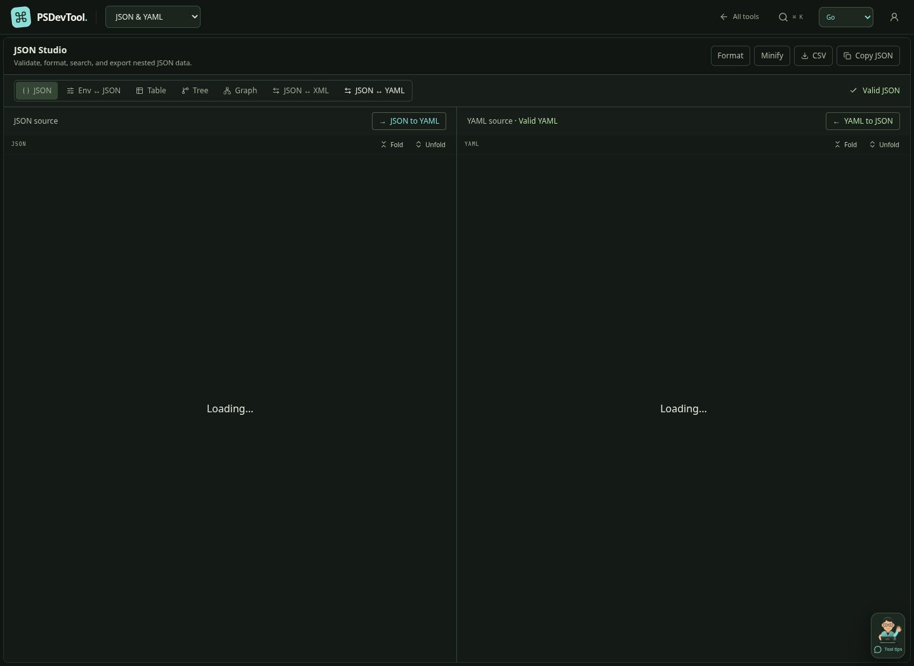
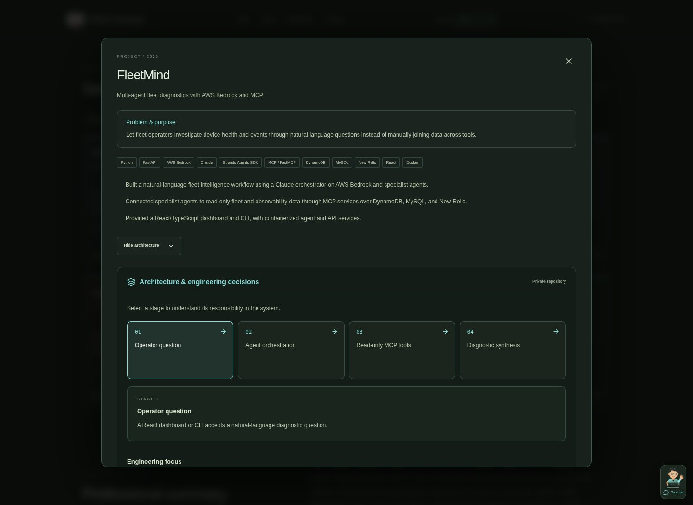

# Workspace, tools, and portfolio redesign

The overview, all 18 tool surfaces, and portfolio share a charcoal visual system with five selectable language accents: Node.js, Python, TypeScript, Go, and Rust. The selected theme and tool favorites persist in browser storage; storage failures do not block the app.

The portfolio now introduces Prakash directly. Its animated cartoon developer guide cycles factual stories from the existing resume and projects. Project cards show real summaries and technology tags, with details and existing architecture walkthroughs. Opening project details also offers a guide specific to that project. The abstract sculpture and decorative cube cards have been removed from the active pages.

Each tool includes a compact, dismissible guide with context-specific tips. It opens only when requested. Guide text can optionally be read aloud through the browser's speech feature. It never starts audio automatically. Character expressions change on click, with subtle wave/blink animation disabled by reduced-motion preferences.

Tool panels, forms, tables, graphs, and Monaco editors use the shared palette, clearer text, focus feedback, subtle panel depth, and entrance motion. Comparison inputs and JSON source inputs distinguish object keys, strings, numbers, booleans, null, and nested brackets. Monaco provides bracket-pair coloring and guides. Comparison includes a runnable JSON example and a visible mobile return-to-input action. Very large inputs skip the lightweight input coloring to keep typing responsive.

Existing tool routes and resume data remain. The shared ManagedDiffEditor releases anonymous models after the diff widget is disposed, fixing the Monaco 0.55 cleanup error.

## Development

```sh
npm install
npm run dev
npm run build
```

No additional runtime dependencies or credentials are required.

## Validation

Production build (TypeScript/Vite), focused ESLint checks for the new shared components, 21 Chromium checks across all tool routes and selected editing/comparison interactions, and five additional checks for theme persistence, career stories, project-specific guidance, tool tips, and mobile layouts. No uncaught browser errors in these completed flows. These checks do not exhaustively exercise every file-processing or remote API workflow. Headless Chromium uses the environment's installed CA pins to load the existing Monaco CDN; analytics and ads are blocked during QA.

## Previews




[Mobile portfolio](redesign/mobile.jpg)

## Recruiting content and compact workspaces

Project descriptions and architecture stages now come from a source review of all ten listed repositories. See [the source-review notes](portfolio-source-review.md). The profile includes the exact merged Liquibase PR, corrected project stacks, source-linked engineering case studies, and a downloadable text profile with standard recruiting headings.

Tool navigation uses a single 54px desktop / 49px mobile header and grouped tool picker. The horizontal tool strip and duplicate tool-introduction header have been removed. The guide launcher is smaller, and its speech icon no longer inherits the character illustration's dimensions.

JSON/XML/YAML inputs use Monaco with visible gutter folding arrows, Fold/Unfold actions, syntax coloring, and explicit two-way conversion controls. Browser checks cover all 18 routes plus folding, both conversion directions, the profile download, all ten architecture cases, and mobile theme persistence. External project applications and their test suites were not executed.



