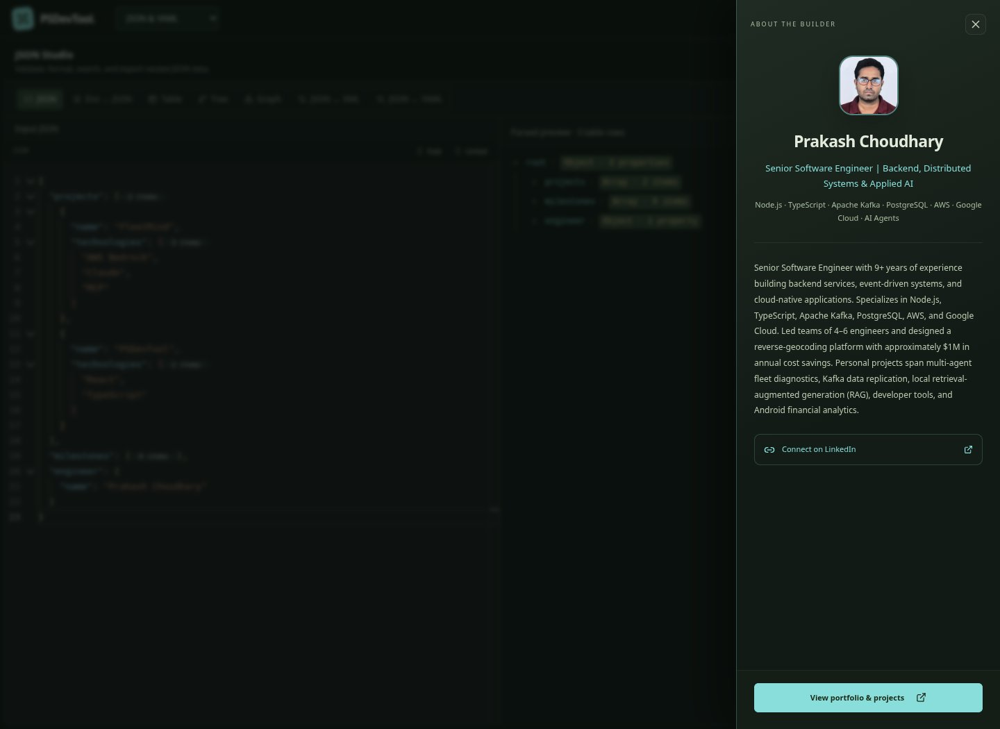
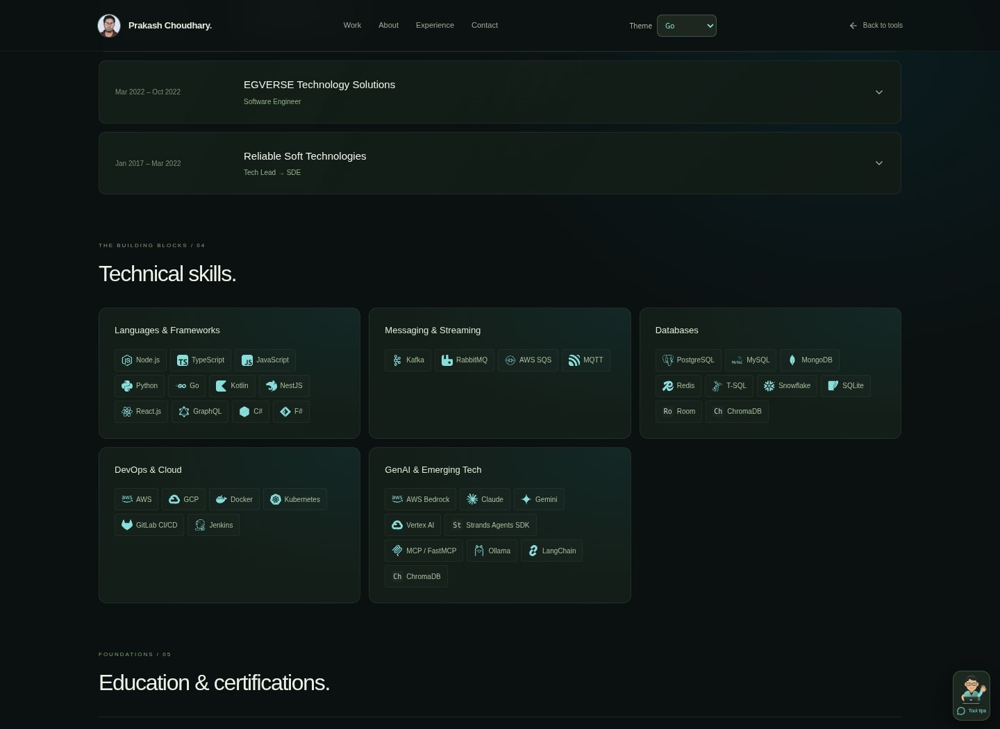
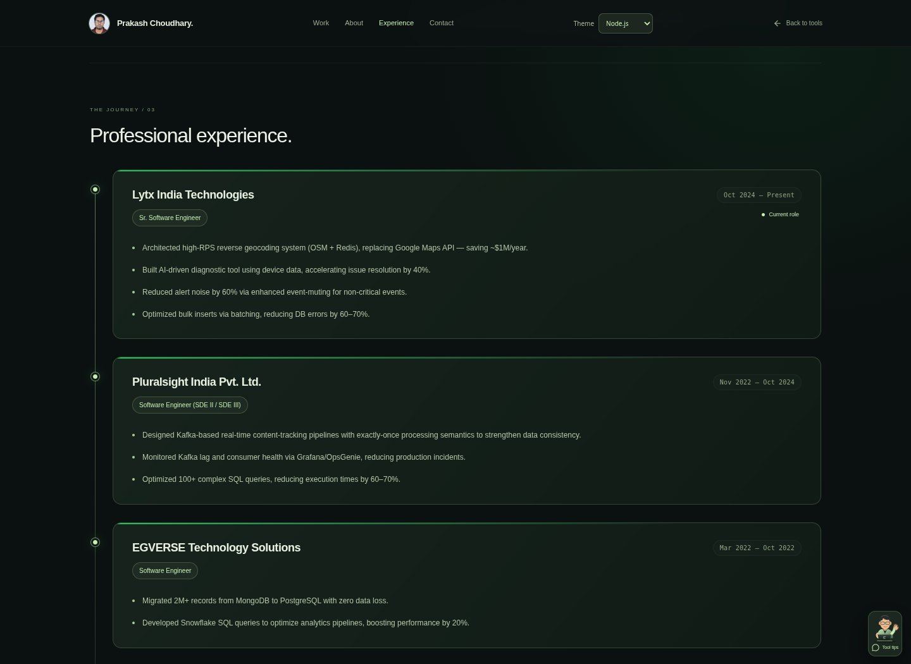
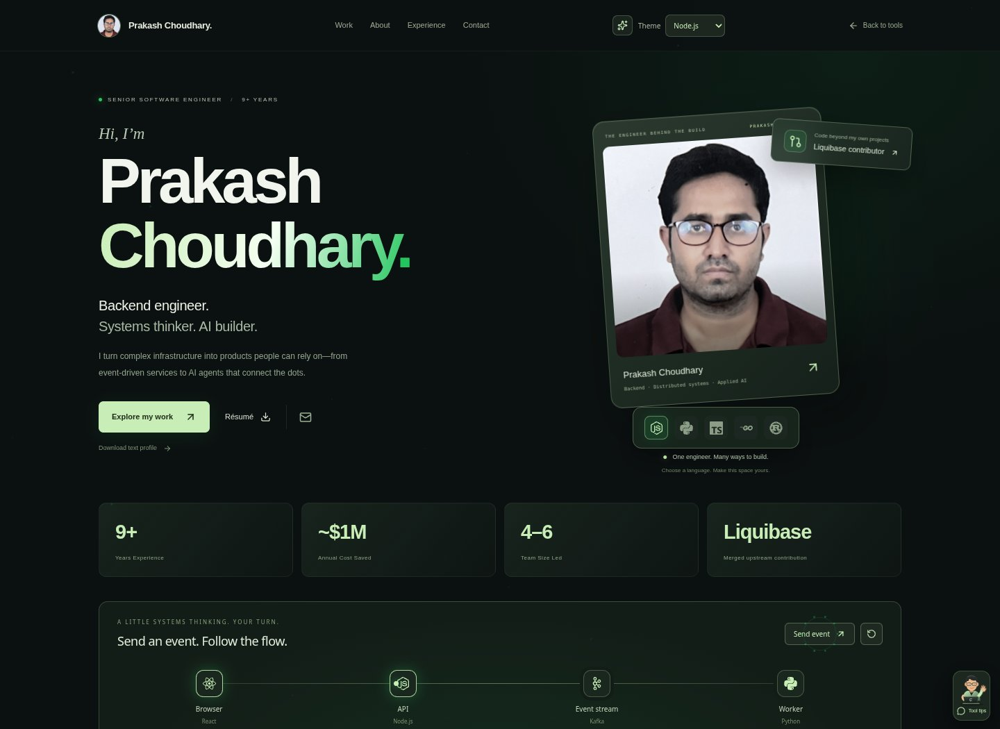

# Workspace, tools, and portfolio redesign

The overview, all 18 tool surfaces, and portfolio share a charcoal visual system with five selectable language accents: Node.js, Python, TypeScript, Go, and Rust. The selected theme and tool favorites persist in browser storage; storage failures do not block the app.

The portfolio now introduces Prakash directly. Its animated cartoon developer guide cycles factual stories from the existing resume and projects. Project cards show real summaries and technology tags, with details and existing architecture walkthroughs. Opening project details also offers a guide specific to that project. The abstract sculpture and decorative cube cards have been removed from the active pages.

Each tool includes a compact, dismissible guide with context-specific tips. It opens only when requested. Guide text can optionally be read aloud through the browser's speech feature. It never starts audio automatically. Character expressions change on click, with subtle wave/blink animation disabled by reduced-motion preferences.

Tool panels, forms, tables, graphs, and Monaco editors use the shared palette, clearer text, focus feedback, subtle panel depth, and entrance motion. Comparison inputs and JSON source inputs distinguish object keys, strings, numbers, booleans, null, and nested brackets. Monaco provides bracket-pair coloring and guides. Comparison includes a runnable JSON example and a visible mobile return-to-input action. Very large inputs skip the lightweight input coloring to keep typing responsive.

Existing tool routes and resume data remain. The shared ManagedDiffEditor releases anonymous models after the diff widget is disposed, fixing the Monaco 0.55 cleanup error.

## Development

```sh
npm install
npm run dev
npm run build
```

No additional runtime dependencies or credentials are required.

## Validation

Production build (TypeScript/Vite), focused ESLint checks for the new shared components, 21 Chromium checks across all tool routes and selected editing/comparison interactions, and five additional checks for theme persistence, career stories, project-specific guidance, tool tips, and mobile layouts. No uncaught browser errors in these completed flows. These checks do not exhaustively exercise every file-processing or remote API workflow. Headless Chromium uses the environment's installed CA pins to load the existing Monaco CDN; analytics and ads are blocked during QA.

## Previews


[Mobile portfolio](redesign/mobile.jpg)

## Recruiting content and compact workspaces

Project descriptions and architecture stages now come from a source review of all ten listed repositories. See [the source-review notes](portfolio-source-review.md). The profile includes the exact merged Liquibase PR, corrected project stacks, source-linked engineering case studies, and a downloadable text profile with standard recruiting headings.

Tool navigation uses a single 54px desktop / 49px mobile header and grouped tool picker. The horizontal tool strip and duplicate tool-introduction header have been removed. The guide launcher is smaller, and its speech icon no longer inherits the character illustration's dimensions.

JSON/XML/YAML inputs use Monaco with visible gutter folding arrows, Fold/Unfold actions, syntax coloring, and explicit two-way conversion controls. Browser checks cover all 18 routes plus folding, both conversion directions, the profile download, all ten architecture cases, and mobile theme persistence. External project applications and their test suites were not executed.


## Portrait-led portfolio, technology marks, and array counts

The portfolio now leads with Prakash's name and portrait, a layered card with pointer tilt, stronger language-theme lighting, a theme-logo dock, a direct Liquibase contribution link, and more expressive project/experience/skill surfaces. The optional cartoon guide remains available and uses the selected language logo on its laptop. Technology chips use local Simple Icons / Devicon marks where available, with readable text badges for unsupported marks; sources and licenses live under `public/technology`.

The builder drawer now inherits the theme, displays the complete summary in a scrollable body, keeps its action available, and uses native dialog focus/Escape behavior.

Valid JSON arrays show non-editable inline item counts, including nested and empty arrays. Counts follow edits, remain on visible folded-array opening lines, and do not enter copied JSON. Invalid input clears them. Count analysis is debounced and omitted above 2 MB to limit editor work.

Validation: build, focused ESLint, eight array-scanner boundary cases, and seven Chromium interaction checks covering nested/folded counts, editing and copy integrity, invalid-input clearing, themed drawer/Escape, all five laptop logos, toolkit icons/case study access, and mobile portfolio navigation. Reduced-motion preferences disable the new decorative animation.





## Career timeline

Professional experience is presented as a connected timeline with milestone dots, role/date badges, and fully expanded role details. IntersectionObserver follows the portfolio's scroll container and reveals each card once when it enters view. Reduced-motion preferences and print styles keep the content visible without reveal motion. All resume text remains mounted and the data is unchanged.

The portrait-card arrow links directly to Prakash's LinkedIn profile in a new tab, with an accessible link label and keyboard focus treatment.

Validation: production build, focused ESLint, and four Chromium checks for sequential role reveal, LinkedIn click/new-tab navigation, reduced motion, and mobile overflow pass without uncaught browser errors.



## Interactive motion layer

Site-wide effects now include theme-colored pointer trails and click ripples, pointer lighting and subtle tilt on cards, section entrances, button feedback and sheen, logo reactions, drawer/dialog entrances, and smooth theme-color transitions. Text editors and inputs do not emit pointer effects while being edited. Decorative canvas work is bounded and skips rendering when the document is hidden; event listeners and animation frames are cleaned up on teardown.

The home page and portfolio include a playable event-flow model: visitors send local simulated events through Browser → API → Kafka → Worker, follow animated packets, inspect sent/delivered counts, and reset. These counters describe only the local model, not production system performance.

A compact motion control beside the theme selector pauses effects across the site and remembers the choice. System reduced-motion preferences disable automatic effects; content stays visible, and the event demo still works without movement.

Validation: build, focused ESLint, and nine Chromium scenarios cover event delivery/reset, persistent pause/resume, pointer lighting, JSON editing with effects active, 320px/390px tool and home layouts, and system reduced motion. No uncaught browser errors in these completed flows.


