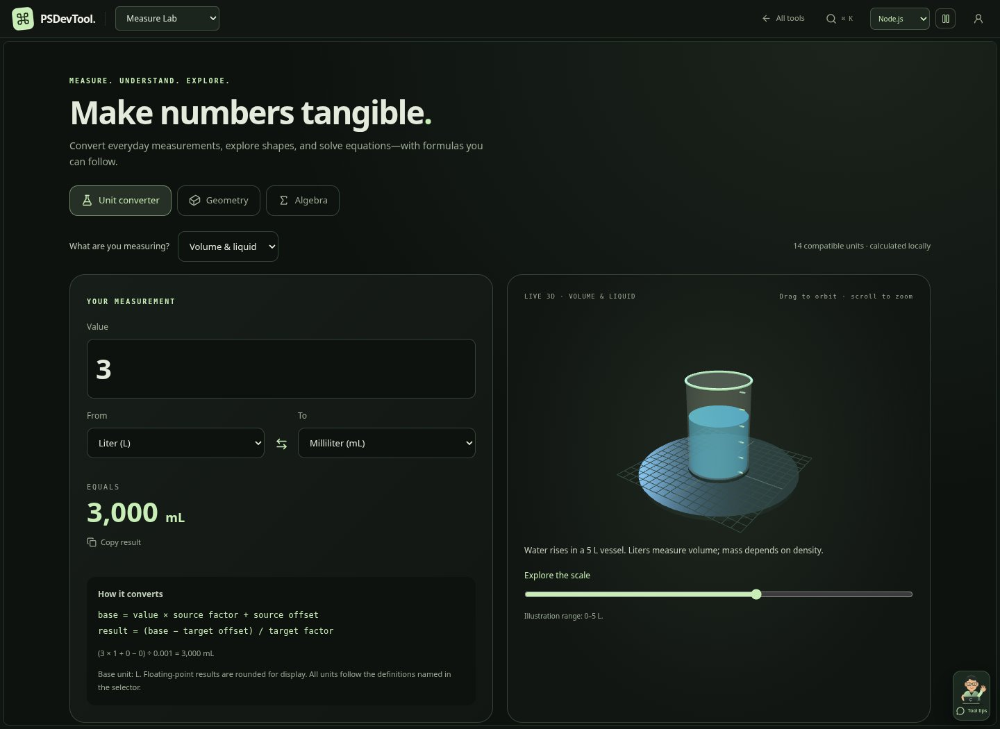
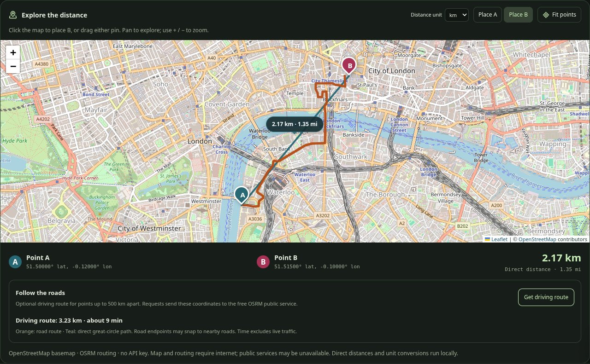

# Workspace, tools, and portfolio redesign

The overview, all 18 tool surfaces, and portfolio share a charcoal visual system with five selectable language accents: Node.js, Python, TypeScript, Go, and Rust. The selected theme and tool favorites persist in browser storage; storage failures do not block the app.

The portfolio now introduces Prakash directly. Its animated cartoon developer guide cycles factual stories from the existing resume and projects. Project cards show real summaries and technology tags, with details and existing architecture walkthroughs. Opening project details also offers a guide specific to that project. The abstract sculpture and decorative cube cards have been removed from the active pages.

Each tool includes a compact, dismissible guide with context-specific tips. It opens only when requested. Guide text can optionally be read aloud through the browser's speech feature. It never starts audio automatically. Character expressions change on click, with subtle wave/blink animation disabled by reduced-motion preferences.

Tool panels, forms, tables, graphs, and Monaco editors use the shared palette, clearer text, focus feedback, subtle panel depth, and entrance motion. Comparison inputs and JSON source inputs distinguish object keys, strings, numbers, booleans, null, and nested brackets. Monaco provides bracket-pair coloring and guides. Comparison includes a runnable JSON example and a visible mobile return-to-input action. Very large inputs skip the lightweight input coloring to keep typing responsive.

Existing tool routes and resume data remain. The shared ManagedDiffEditor releases anonymous models after the diff widget is disposed, fixing the Monaco 0.55 cleanup error.

## Development

```sh
npm install
npm run dev
npm run build
```

Leaflet powers the distance map. No map API key or credentials are required.

## Validation

Production build (TypeScript/Vite), focused ESLint checks for the new shared components, 21 Chromium checks across all tool routes and selected editing/comparison interactions, and five additional checks for theme persistence, career stories, project-specific guidance, tool tips, and mobile layouts. No uncaught browser errors in these completed flows. These checks do not exhaustively exercise every file-processing or remote API workflow. Headless Chromium uses the environment's installed CA pins to load the existing Monaco CDN; analytics and ads are blocked during QA.

## Previews


[Mobile portfolio](redesign/mobile.jpg)

## Recruiting content and compact workspaces

Project descriptions and architecture stages now come from a source review of all ten listed repositories. See [the source-review notes](portfolio-source-review.md). The profile includes the exact merged Liquibase PR, corrected project stacks, source-linked engineering case studies, and a downloadable text profile with standard recruiting headings.

Tool navigation uses a single 54px desktop / 49px mobile header and grouped tool picker. The horizontal tool strip and duplicate tool-introduction header have been removed. The guide launcher is smaller, and its speech icon no longer inherits the character illustration's dimensions.

JSON/XML/YAML inputs use Monaco with visible gutter folding arrows, Fold/Unfold actions, syntax coloring, and explicit two-way conversion controls. Browser checks cover all 18 routes plus folding, both conversion directions, the profile download, all ten architecture cases, and mobile theme persistence. External project applications and their test suites were not executed.


## Portrait-led portfolio, technology marks, and array counts

The portfolio now leads with Prakash's name and portrait, a layered card with pointer tilt, stronger language-theme lighting, a theme-logo dock, a direct Liquibase contribution link, and more expressive project/experience/skill surfaces. The optional cartoon guide remains available and uses the selected language logo on its laptop. Technology chips use local Simple Icons / Devicon marks where available, with readable text badges for unsupported marks; sources and licenses live under `public/technology`.

The builder drawer now inherits the theme, displays the complete summary in a scrollable body, keeps its action available, and uses native dialog focus/Escape behavior.

Valid JSON arrays show non-editable inline item counts, including nested and empty arrays. Counts follow edits, remain on visible folded-array opening lines, and do not enter copied JSON. Invalid input clears them. Count analysis is debounced and omitted above 2 MB to limit editor work.

Validation: build, focused ESLint, eight array-scanner boundary cases, and seven Chromium interaction checks covering nested/folded counts, editing and copy integrity, invalid-input clearing, themed drawer/Escape, all five laptop logos, toolkit icons/case study access, and mobile portfolio navigation. Reduced-motion preferences disable the new decorative animation.


## Career timeline

Professional experience is presented as a connected timeline with milestone dots, role/date badges, and fully expanded role details. IntersectionObserver follows the portfolio's scroll container and reveals each card once when it enters view. Reduced-motion preferences and print styles keep the content visible without reveal motion. All resume text remains mounted and the data is unchanged.

The portrait-card arrow links directly to Prakash's LinkedIn profile in a new tab, with an accessible link label and keyboard focus treatment.

Validation: production build, focused ESLint, and four Chromium checks for sequential role reveal, LinkedIn click/new-tab navigation, reduced motion, and mobile overflow pass without uncaught browser errors.


## Interactive motion layer

Site-wide effects now include theme-colored pointer trails and click ripples, pointer lighting and subtle tilt on cards, section entrances, button feedback and sheen, logo reactions, drawer/dialog entrances, and smooth theme-color transitions. Text editors and inputs do not emit pointer effects while being edited. Decorative canvas work is bounded and skips rendering when the document is hidden; event listeners and animation frames are cleaned up on teardown.

The event-flow playground has been removed from home and portfolio at the owner’s request. The separate Liquibase summary statistic has also been removed; the actual contribution link remains.

A compact motion control beside the theme selector pauses effects across the site and remembers the choice. System reduced-motion preferences disable automatic effects; content stays visible.

Validation: build, focused ESLint, and nine Chromium scenarios cover event delivery/reset, persistent pause/resume, pointer lighting, JSON editing with effects active, 320px/390px tool and home layouts, and system reduced motion. No uncaught browser errors in these completed flows.


## Rotating engineering focus

The hero types Backend Engineer, Cloud Engineer, Applied AI Engineer, Full-Stack Developer, and Software Architect character by character (75 ms), holds each complete title for 1.8 seconds, deletes it (35 ms per character), and pauses briefly before the next title. The caret blinks independently without fading the whole title. Pausing or system reduced motion displays a complete title; hidden tabs suspend the timer. A dedicated visually hidden summary exposes all roles to screen readers without repeated live announcements or duplicated visible text. Reserved line height prevents vertical jumps. Historical job titles are unchanged.

Validation: production build, focused ESLint and Chromium checks cover typing, the complete-title hold, deletion, next-role typing, pause/resume, reduced motion, hidden summary and 320px layout.

## Live experience and distance map

Career duration derives from 2 January 2017 and the current date, refreshing at local midnight and when the tab becomes visible. Hero, statistics, builder summary, and downloaded text profile share the same calculation.

Geo Distance now uses Leaflet (BSD-2-Clause) with standard OpenStreetMap tiles and visible contributor attribution. No paid service or API key is required. Users can place A/B by clicking, drag either marker, inspect coordinate popups, and fit the great-circle path. Coordinate edits and presets update map, labels, kilometers and miles together. Great-circle samples unwrap the date line; coincident and antipodal points remain finite. The map is displayed immediately below coordinate inputs.

Tiles require a network connection and follow the public OSM tile policy: standard tile URL, visible attribution, browser caching, no prefetch or offline download. Tile failures expose a retry action while local markers and calculations remain available. Public OSM tiles have no availability guarantee; a higher-traffic deployment may need a suitable tile provider or self-hosting. The path is direct geographic distance, not road routing. Coordinates are processed locally; tile requests go to OpenStreetMap.

## Measure Lab and road distance

`#/measure` (also `#/units`) adds 119 units across 17 compatible measurement categories: length, mass, volume, area, temperature, time, speed, pressure, energy, power, angle, storage, frequency, force, density, current and voltage. Temperature uses affine offsets, storage distinguishes SI/IEC, and liquid measures distinguish US/Imperial definitions. Swapping preserves the measurement. Each category has a procedural Three.js scene: height figure/scale, sugar container, water vessel, tiled floor, thermometer, clock, vehicle, piston, battery, lamp, angle arm, storage rack, wave, spring, density vessel, charge circuit or voltage meter. Inputs and a scale slider update the models; motion preferences stop automatic movement while orbit controls remain usable. Illustrations have a stated range and saturate visually without limiting numerical conversion. WebGL failure keeps calculations available.

Geometry includes 15 plane/solid shapes with formulas, area/perimeter/volume/surface results where applicable, length-unit selection and metric equivalents. Algebra includes linear/quadratic equations (including complex roots), two-equation systems, percentages, arithmetic sequences and geometric sequences. Graphs are illustrative and rescale each axis independently. Numerical work uses JavaScript floating point and is rounded for display; no symbolic solver or universal unit coverage is claimed.

Geo Distance now offers an explicit **Get driving route** action for valid points up to 500 km apart. It contacts the free public OSRM service only on request, shows a separate orange road path, road distance and approximate duration, and keeps the teal direct path. Both distances support km/m/mi/ft/nmi. Results are tied to the requested coordinates and disappear after either point changes. Timeouts and no-road responses preserve the local calculator. Public routing is best effort, road points can snap, and travel time excludes live traffic. The public service requires no API key; routing coordinates are sent to OSRM.

Validation: production build and focused ESLint; `npm run test:measurements` exercises 138 unit round-trips/shape/geodesic cases plus known conversions, algebra, invalid inputs and anniversary boundaries. Eight Chromium scenarios cover all 17 scenes, all 15 shapes, all six algebra tools, input/swap behavior, invalid temperature/triangle values, 320px layout and reduced motion. Eight map scenarios cover actual tile loading and live OSRM routing, fixture-based route results/unit changes, pin click/drag, stale-route clearing, no-road fallback, 320px map layout, tile-failure recovery, and malformed route geometry. The live London example returned 3.23 km driving versus 2.17 km direct distance; this is an observed test result, not a fixed benchmark.




Additional Chromium checks verify animated liquid edits, direct orbit interaction, stable paused rendering, and command-palette discovery.

## Workspace usability refinement

All 19 tools and their route IDs remain. The catalog now shows every tool, with four shared task groups used by navigation and keyboard search. The overview is shorter and keeps the interactive guide. Recent history stores only tool IDs.

Tool views are lazy-loaded on first use and retained while switching within the workspace; inactive panes are hidden and inert. This preserves edited inputs without mounting every editor at startup. Three.js resources are released while their tool is inactive; architecture simulation and JWT clocks pause when inactive. Architecture simulation starts only when requested. Pointer trails and click ripples stay on presentation pages, preserving direct 3D/map interaction inside tools. A tool-level error boundary offers retry, reload and a return to the catalog. Reload explicitly resets unsaved input.

Shared styles improve surface separation, muted-text contrast, control sizes, keyboard focus and header hierarchy. Search uses a native modal dialog, a combobox/listbox, task keywords, arrow/Enter/Escape navigation, empty-result recovery and focus restoration. Contextual tool help explains workflows and data/network behavior.

JSON, JWT, API Desk, DebugFlow, Measure Lab and Geo Distance use consistent headers or header styling. DebugFlow has a clear empty state, one sample selector, shorter analysis labels, expandable metadata, and separate mobile input/analysis panes. Its inferred call flow and rule-based suggestions are labeled accordingly. Geo Distance hides advanced breakdowns and estimates behind disclosures and validates coordinate drafts without silently converting empty/invalid input into zero. Measure Lab offers a remembered 3D toggle and on-demand conversion formulas; all 119 units, 15 shapes and six algebra tools remain. Clipboard-denied messages provide manual-copy recovery in JSON, JWT, DebugFlow and Measure Lab.

JWT verification resets immediately on input changes, only marks supported HS256 tokens verified, and ignores outdated asynchronous verification results. Unsupported algorithms are labeled explicitly. Secrets are concealed until revealed. API request proxies stay available as explicit choices; new/sample/imported requests default to direct connections, and OpenAPI spec failures no longer silently fall back through corsproxy.io. Existing saved proxy choices are preserved and disclosed beside the request configuration.

The initial minified app entry was approximately 599 KiB before this pass and approximately 273 KiB after initial lazy-loading changes; this measures the entry bundle, not total downloaded application size or real-world load time. Large diagram/document chunks still exist and load for their respective tools.

Validation for this pass: production build, focused ESLint, `test:measurements` and `test:catalog` pass. Ten Chromium workflow scenarios cover lazy opening, all 19 routes, retained input, search/empty recovery, modal focus, the 3D toggle/formulas, coordinate drafts, DebugFlow samples, all 19 mobile tool pickers, and recent tools. Seven reliability scenarios cover supported/unsupported/malformed JWTs, wrong secrets, late verification races, denied clipboard access, and explicit OpenAPI proxy use. Six additional checks cover the 19-card catalog, 320px overview, mobile analysis space, live coordinate-link changes, focus outlines and reduced motion. Four editor checks cover JSON copy integrity after tool switching, folding, retained architecture simulation and mobile reopening. Two intentional download-failure checks cover the tool error boundary and reload recovery. The six README tool screenshots were refreshed from the production build. No uncaught application errors occurred in the completed normal workflows. These checks do not substitute for independent usability research or exhaustive testing of every tool.


[Mobile overview](redesign/workspace-mobile.jpg)
