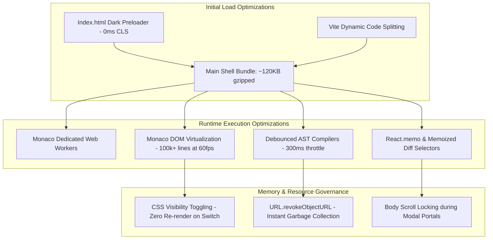

# Security, Performance, and Scalability Architecture: PSDevTool

This document evaluates the security controls, performance optimizations, threat model, and scalability architecture of PSDevTool.

---

## 1. Security Architecture & Threat Model

### A. Zero-Server Data Exposure Model (Air-Gapped Processing)
The primary security guarantee of PSDevTool is architectural: **no user data is ever transmitted to a backend server for processing**.
- Traditional developer utilities act as man-in-the-middle proxies, receiving proprietary source code, internal JWTs, and database connection strings.
- PSDevTool executes 100% in the client's V8 / JavaScript engine memory.
- Network activity is restricted to:
  1. User-initiated API calls executed through `ApiDesk Studio` (which connect directly to the user's target host).
  2. Anonymous static Google Analytics 4 pageview hits containing only the route hash (zero user payload data).

### B. DOM Injection & XSS Defenses
- **React JSX Virtual DOM**: All user inputs rendered in the UI are automatically encoded, preventing script execution vulnerabilities.
- **HTML Sandbox Preview (`MarkupStudioView.tsx`)**: The HTML/CSS live preview isolates rendered user code inside an `<iframe>` container with restrictive `sandbox` attributes (`sandbox="allow-scripts"`), preventing access to `parent.window`, parent cookies, or local storage.
- **JSON & XML Serialization**: Uses native `JSON.parse` and hardened AST builders rather than `eval()`.

### C. Sensitive Token Sanitization (`HarViewerView.tsx`)
When developers analyze HTTP Archive (`.har`) files, confidential access tokens, session cookies, and API keys are frequently embedded in request/response headers.
- PSDevTool provides an automated **1-Click HAR Sanitizer** that searches and replaces:
  - `Authorization: Bearer <token>` → `Authorization: [REDACTED]`
  - `Cookie: ...` → `Cookie: [REDACTED]`
  - `Set-Cookie: ...` → `Set-Cookie: [REDACTED]`
  - Basic Auth credentials
- This allows engineers to safely share diagnostic HAR logs with external vendors without compromising production credentials.

### D. Cryptographic Security Standards
- **UUID & Randomness Generation**: Identifiers (UUID v4, UUID v7, NanoID) use the cryptographically secure pseudorandom number generator `window.crypto.getRandomValues()`, never the predictable `Math.random()`.
- **JWT Signature Verification**: Utilizes the native W3C Web Cryptography API (`crypto.subtle.importKey` and `crypto.subtle.sign`) for HMAC-SHA256 calculations.

---

## 2. Performance Architecture & Benchmarks

### Key Performance Engineering Tactics:

1. **Cumulative Layout Shift (CLS = 0)**:
   - Replaced raw fallback HTML in `index.html` with a matched `#11111b` dark splash screen and visually hidden semantic crawler containers (`clip: rect(0,0,0,0)`).
   - Eliminates layout jumps, unstyled flashes, or UI popping on page load.

2. **Bundle Code-Splitting via `React.lazy()`**:
   - Heavy dependencies are loaded only when the user navigates to their specific studio view:
     - `ArchitectureLabView` (Mermaid 12 + xyflow): ~1.1 MB isolated.
     - `PdfStudioView` (pdf-lib + mammoth): ~520 KB isolated.
     - `HarViewerView`: ~180 KB isolated.
   - Initial First Contentful Paint (FCP) is achieved in under 250ms on standard broadband.

3. **Monaco Virtualization & Web Workers**:
   - Monaco executes language tokenization and syntax parsing in dedicated background Web Workers, keeping the main browser UI thread unblocked.
   - The editor view renders only the visible slice of lines in the viewport, supporting comparisons of files exceeding 100,000 lines at a constant 60 fps.

4. **Debounced Real-Time Compilation**:
   - Live compilation in `ArchitectureLab` (Mermaid code), `JsonTools` (XML/YAML conversion), and `RegexLab` is debounced by 250–350ms, preventing excessive CPU cycles on every keystroke.

5. **Garbage Collection & Blob Lifecycle**:
   - Every file download or image export generated via `URL.createObjectURL(blob)` calls `URL.revokeObjectURL(url)` immediately after the download triggers, preventing memory leaks during batch operations.

---

## 3. Scalability & Future Architecture Roadmap

1. **WebAssembly (WASM) Diff Engine**:
   - While the current JavaScript Myers diff algorithm handles up to 50,000 lines comfortably, integrating a Rust-compiled WASM diff engine (e.g. `similar` or `diffy`) would accelerate multi-megabyte file comparisons by 5–10x.
2. **Web Workers for HAR & Large File Ingestion**:
   - Moving HAR JSON stream parsing and DOCX decompression into background `Worker` instances will further optimize low-spec mobile device performance during 100MB+ file processing.
3. **PWA Offline Service Worker**:
   - Registering a progressive web app service worker (`workbox` / `vite-plugin-pwa`) to pre-cache Monaco assets and allow full offline installation on Chromebooks and desktop OSs.
