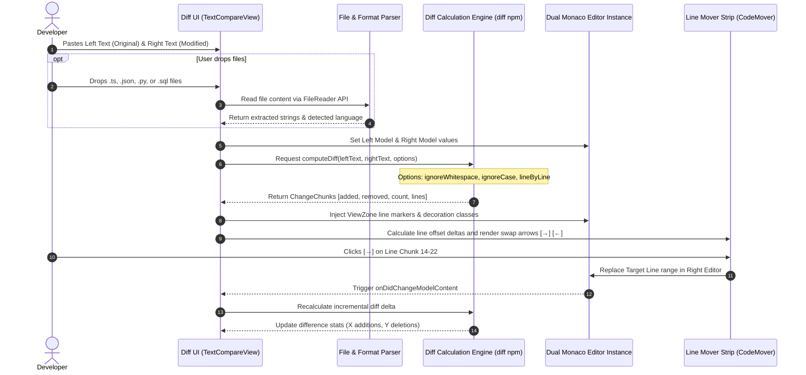
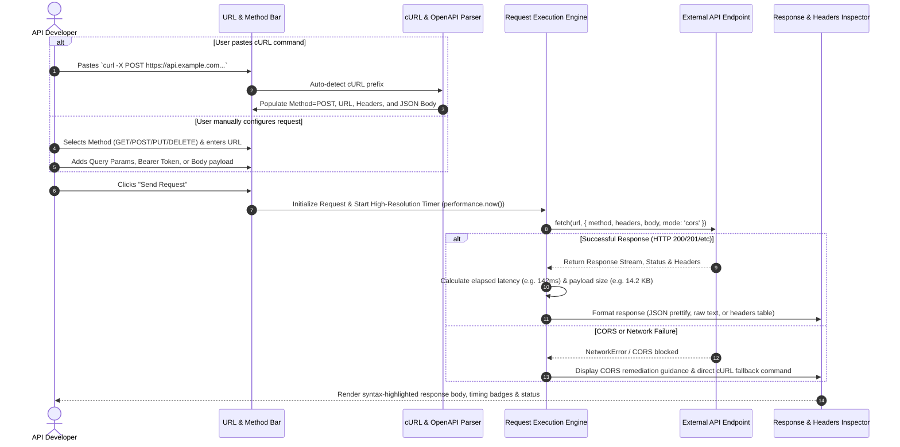
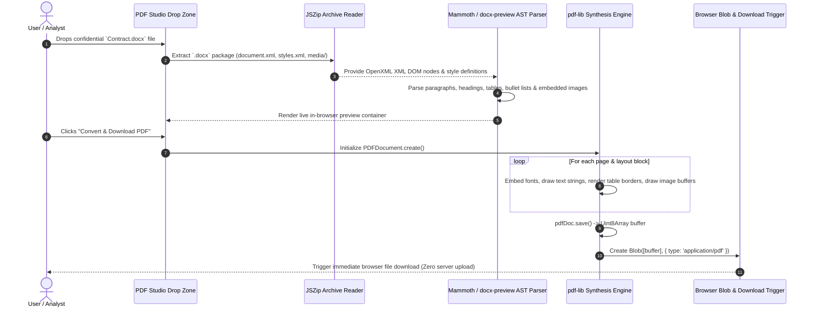
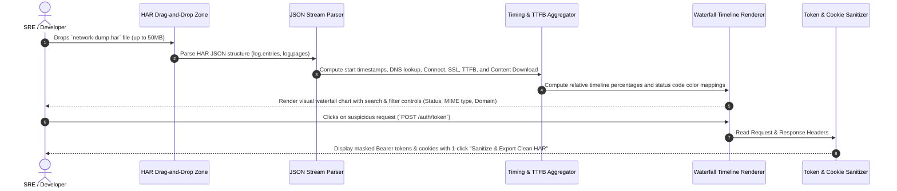

# Application Workflows & User Journeys: PSDevTool

This document maps the end-to-end application workflows, user interaction cycles, and execution pipelines across PSDevTool's core utilities.

---

## 1. Monaco Code & Text Diff Comparison Workflow

### Step-by-Step Execution:
1. **Input Ingestion**: Text can be directly typed, pasted from clipboard, or loaded by dragging and dropping local files.
2. **Language Auto-Detection**: Monaco's language worker detects the syntax (JavaScript, TypeScript, Python, JSON, SQL, HTML, CSS, YAML, Markdown, etc.).
3. **Diff Computation**: The in-memory Myers diff algorithm parses line-by-line differences, grouping them into added, removed, and unmodified spans.
4. **Synchronized Viewport**: The custom scroll listener synchronizes the vertical and horizontal positions of both editors.
5. **Interactive Code Transfer (`CodeMover`)**: Hovering over diff blocks displays inline transfer buttons (`→` or `←`) allowing granular cherry-picking of specific lines between buffers.

---

## 2. ApiDesk Studio: REST / GraphQL & Swagger Workflow

---

## 3. Client-Side Word to PDF Conversion Workflow

---

## 4. HAR Network Waterfall Inspection Workflow

