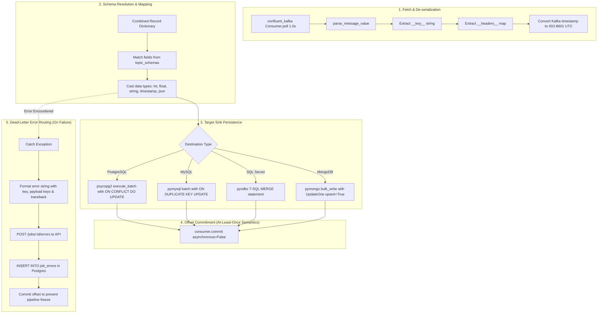
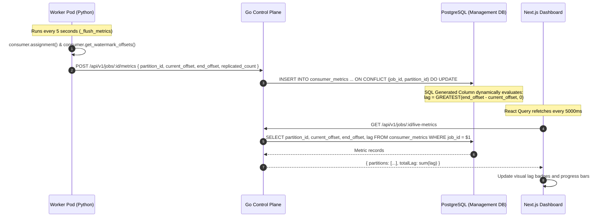

# Data Flow & Stream Processing Documentation

This document describes how data enters, transitions across boundaries, is transformed and validated, persists in storage systems, and is presented to users in **KafkaUI**.

---

## 1. High-Level Data Flow Architecture (DFD Level 0)

```mermaid
flowchart LR
    Producer[External Producer / Client UI] -->|1. Event Ingest & Payload| ControlPlane[Control Plane Gateway (Go)]
    ControlPlane -->|2. Validated Record| KafkaTopic[(Kafka Topic Log)]
    
    KafkaTopic -->|3. Partition Stream| WorkerPool[Kubernetes Worker Pods]
    WorkerPool -->|4. Field Mapping & Transformation| TargetDB[(Target Sink DB: Postgres / Mongo / MySQL)]
    
    WorkerPool -->|5. Lag & Watermark Telemetry| MgmtDB[(PostgreSQL Management DB)]
    MgmtDB -->|6. Aggregated Metrics| ControlPlane
    ControlPlane -->|7. Real-Time Telemetry| BrowserUI[Next.js Client UI]
```

---

## 2. In-Depth Operational Data Flows

### 2.1 Ingest & Schema Validation Pipeline

```
[Raw Payload: JSON/String]
           │
           ▼
[Control Plane: Gin Handler (internal/api/handlers/topic.go)]
           │
           ├─► [Schema Cache Lookup: internal/validation/Cache]
           │         │
           │         ├─► If JSON Schema: lib/qri-io/jsonschema validator
           │         ├─► If Avro: github.com/hamba/avro binary decoder test
           │         └─► If Invalid: Return HTTP 400 + Validation Error
           │
           ▼
[Kafka Producer: internal/kafka/producer.go]
           │
           ├─► Constructs kafka.Message:
           │     • Topic: string
           │     • Partition: int (or automatic round-robin hashing)
           │     • Key: []byte
           │     • Value: []byte
           │     • Headers: []kafka.Header
           │     • Time: time.Now()
           ▼
[TCP Socket Transmission to Broker Partition Leader]
```

---

### 2.2 Replication Worker Data Pipeline (Kafka → Destination DB)

The Python worker runtime in `/worker/main.py` processes event records through five distinct phases:



---

## 3. Metrics Telemetry & Lag Aggregation Data Flow



---

## 4. State Management Matrix

| State Type | Location | Persistence Mechanism | Refresh Strategy |
|---|---|---|---|
| **Client Session & Token** | Browser `localStorage` | Client storage (`kafbat_token`, `kafbat_user`) | Cleared on HTTP 401 or manual logout. |
| **Active Cluster Context** | React State / URL Param | Next.js Router (`/clusters/[clusterId]/...`) | Syncs with route parameters. |
| **Topic & Group Queries** | TanStack React Query Cache | Memory (Stale-Time: 5s–30s) | Automated window refocus & background polling. |
| **Job & Schema Configuration** | PostgreSQL 16 | Relational tables with foreign key constraints | Queried on demand with indexed primary keys. |
| **Partition Offsets** | Apache Kafka | `__consumer_offsets` internal compacted topic | Managed by Kafka Group Coordinator. |
| **Worker Deployment State** | Kubernetes Cluster State | `apps/v1.Deployment` in namespace `kafbat` | Synchronized by Go background ticker every 30s. |

---

## 5. Data Formats & Serialization Protocol

### Event Value Formats Supported
1. **JSON Object**: Decoded automatically into key-value map for database field mapping.
2. **Scalar JSON** (number, string, boolean): Wrapped into `{"value": <scalar>}`.
3. **Apache Avro**: Binary payloads decoded against registered Avro schema records (`hamba/avro`).
4. **Protobuf**: Structured binary wire format.
5. **Raw String**: Plain text fallback encoded as UTF-8 with replacement on decoding errors.

### Envelope Metadata Injection
The Python worker injects metadata into each target database record:
- `__key__`: The raw Kafka message key decoded as string.
- `__headers__`: A flattened map of all Kafka message headers.
- `__partition__`: The partition index from which the record was read.
- `__offset__`: The log sequence offset of the record.
- `__timestamp__`: The message publication timestamp in ISO-8601 UTC.
