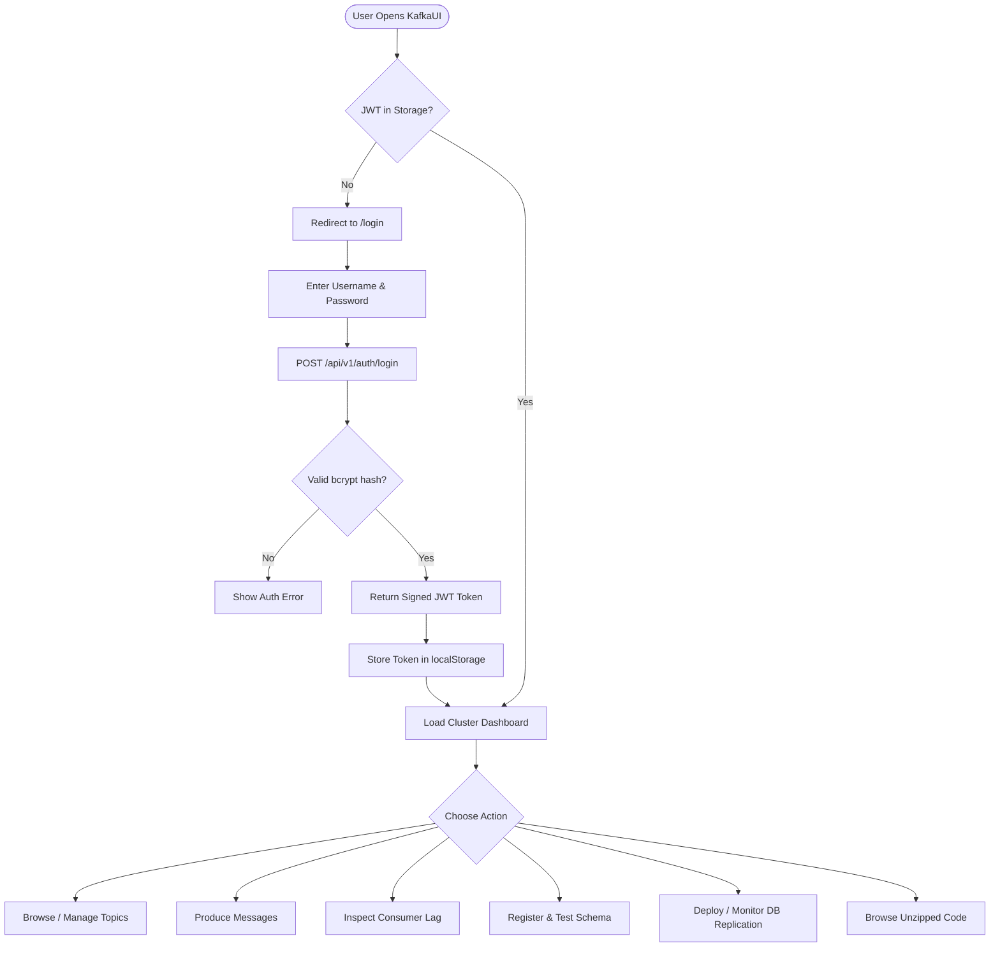
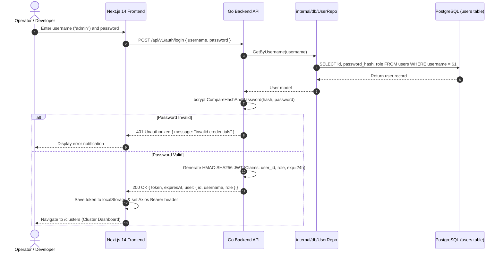
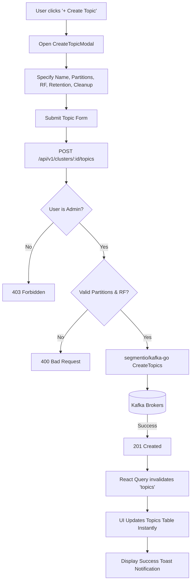
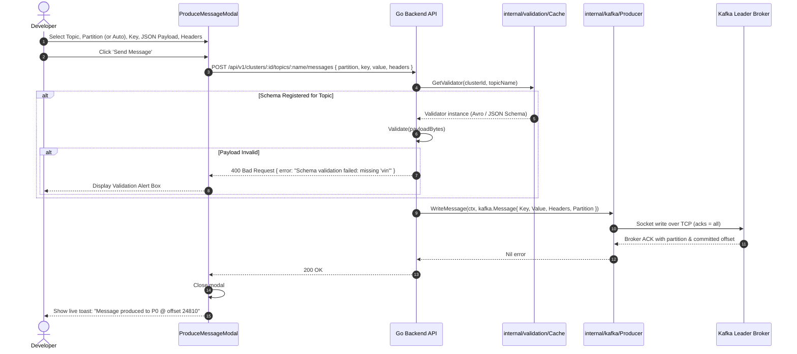
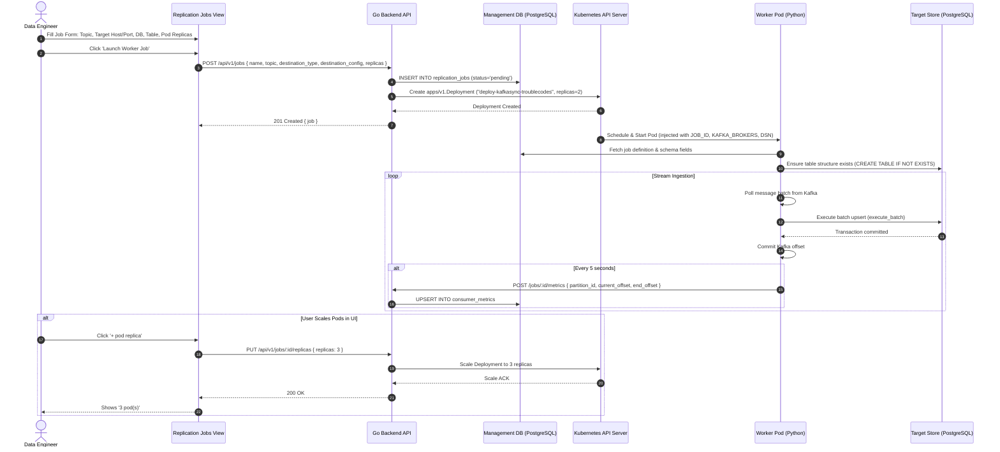

# Application Workflows & User Journey Documentation

This document maps out the end-to-end application workflows, step-by-step operations, and sequential interactions across the UI, Go backend, Kafka brokers, PostgreSQL database, and Kubernetes worker pool.

---

## 1. Global User Journey Map



---

## 2. Journey 1: User Authentication & Role-Based Access Control

### 2.1 Description
Ensures that all cluster administrative operations and schema modifications are secured behind JSON Web Tokens with defined role permissions (`admin` vs `viewer`).

### 2.2 Sequence Diagram


---

## 3. Journey 2: Topic Creation with Partition & Retention Config

### 3.1 Description
Enables operators to create new topics with custom partition counts, replication factors, and configuration overrides (`retention.ms`, `cleanup.policy`, `compression.type`).

### 3.2 Workflow Flowchart


---

## 4. Journey 3: Message Production, Schema Validation & Ingestion

### 4.1 Description
A developer creates a test payload and publishes it directly to a topic. The system dynamically validates the message against the registered Avro or JSON Schema before writing to Kafka.

### 4.2 Sequence Diagram


---

## 5. Journey 4: Consumer Group Monitoring & Offset Reset

### 5.1 Description
A DevOps engineer notices consumer lag building up in a consumer group and needs to inspect individual partition progress or reset offsets to recover processing.

### 5.2 Flowchart
```mermaid
flowchart TD
    OpenCG[User navigates to Consumer Groups] --> FetchGroups[GET /api/v1/clusters/:id/consumer-groups]
    FetchGroups --> KafkaDescribe[Kafka Admin describes consumer groups & offsets]
    KafkaDescribe --> RenderList[Display Group Cards with State & Total Lag]
    RenderList --> ExpandGroup[User expands group 'troublecode-postgres-sync']
    ExpandGroup --> ShowBreakdown[Display Partitions: Committed vs High-Watermark End Offset]
    ShowBreakdown --> ClickReset[User clicks 'Reset to Latest']
    ClickReset --> ConfirmReset{Confirm Reset Action?}
    ConfirmReset -- Yes --> PostReset[POST /api/v1/jobs/:id/reset-offset { position: 'latest' }]
    PostReset --> CommitOffset[segmentio/kafka-go writes offset commit to __consumer_offsets]
    CommitOffset --> UpdateDB[Update consumer_metrics in PostgreSQL]
    UpdateDB --> LagZero[Lag immediately recalculates to 0]
    LagZero --> LiveToast[Show Confirmation Toast: Offsets Advanced]
```

---

## 6. Journey 5: Kubernetes Replication Job Deployment & Worker Sync

### 6.1 Description
A data engineer connects a Kafka topic to PostgreSQL. The control plane provisions an independent Kubernetes deployment with containerized Python workers.

### 6.2 Sequence Diagram

