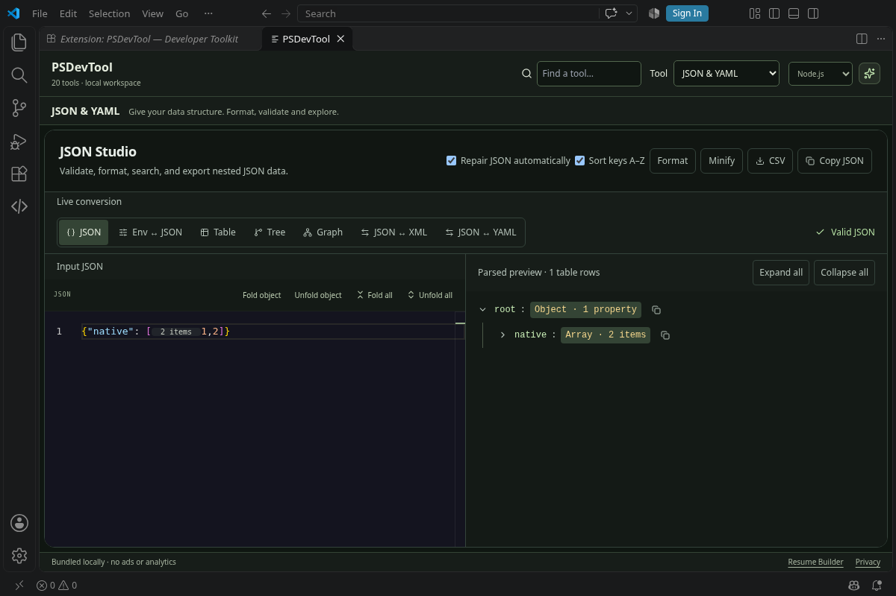

# PSDevTool for Visual Studio Code

Twenty developer tools in one editor tab, built from the same tool components as [PSDevTool](https://psdevtool.online/). The extension bundles the application, Monaco editor, language workers and diagrams. It does not load the hosted website, Google Analytics, or advertisements.



## Install

1. Download `psdevtool-0.1.0.vsix` from the provided build artifact.
2. In VS Code, open **Extensions → … → Install from VSIX…** and choose the file.
3. Run **PSDevTool: Open Toolkit** from the Command Palette, or select the PSDevTool activity-bar icon.

Alternatively:

```sh
code --install-extension psdevtool-0.1.0.vsix
```

This initial release is a locally installable VSIX. It has not been published to the Visual Studio Marketplace. The `pspcps` publisher identifier in the package is not a claim of Marketplace verification.

## Included tools

| Compare & format | Inspect & debug | Create & transform | Calculate & convert |
| --- | --- | --- | --- |
| Diff Checker | API Desk | Architecture Lab | ID Generator |
| JSON & YAML Studio | HAR Viewer | PDF Studio | Time Zones |
| File & Folder Diff | JWT Debugger | Image Studio | Geo Distance |
| Regex Lab | DebugFlow | Image Base64 | Measure Lab |
| Markup Studio | | Resume Builder | URL Tools |
| Case Converter | | | |

Choose a tool from the native sidebar, **PSDevTool: Choose Tool**, or the searchable toolbar inside the panel. Visited non-resume tool panes retain their current inputs while the panel remains open. Closing the panel resets unsaved inputs. Resume profiles can be saved separately using the existing on-device setting and JSON backup/import.

### Use editor text

Select text in a VS Code editor and run **PSDevTool: Open Selection in Toolkit**, also available in the editor context menu. The toolkit opens JSON Studio with a selection banner. Choose **Replace tool input** to insert it into the active code editor, or **Copy selection** to paste it into another tool. Existing input is not overwritten until you choose Replace. Selection import and clipboard messages are limited to 2 MB.

### Copy, export and print

Copy/paste buttons use VS Code's clipboard. Existing download buttons open a native Save dialog; files are written only to the location you choose. Exports are limited to 32 MB per file.

VS Code webviews do not offer Chrome's normal print dialog. Resume Print/PDF and PDF Studio's native Word-print workflow save a static printable HTML file instead. Choose **Open in browser**, then **Print → Save as PDF**. Disable browser headers and footers and select the intended paper size. Existing direct PDF-generation/download operations remain available. Printable HTML excludes executable scripts and contains a restrictive content policy; browser print layout can differ, so review the preview.

## Network and privacy

- The application and Monaco editors are bundled locally. No developer account or PSDevTool server is required to open the tools.
- API Desk sends requests to the endpoints you choose. Browser CORS restrictions still apply; the extension does not provide a privileged HTTP proxy or bypass TLS validation.
- Geo Distance uses OpenStreetMap tiles and optional public OSRM routing. Those features require internet and share the requested coordinates with their providers. Direct distance calculations are local.
- External links open through VS Code's external-link handling. Website privacy/portfolio links open the browser.
- Optional local storage belongs to the extension webview. It is separate from the website's browser storage; export/import resume backups to move profiles.
- The extension does not scan project files, execute terminal commands, or run workspace code. Selection import is explicit; file import uses the webview's file picker. Do not place real secrets in sample requests or exported diagnostics.

## Development

From the repository root:

```sh
npm ci
npm --prefix vscode-extension ci
npm run build:extension
npm run test:extension
npm run package:extension
```

The VSIX is created at `vscode-extension/psdevtool-0.1.0.vsix`. Run VS Code with `--extensionDevelopmentPath=/absolute/path/to/diffwise/vscode-extension` after building to launch a development host. Rebuild and reload the development window after changes.

The host is in `src/extension.cjs`; the shared webview entry is `../src/vscode/main.tsx`. The host exposes only a small validated message protocol for clipboard, user-selected saves, external links and opening output in an untitled editor. `media/catalog.json` is generated from the shared catalog; all 20 tools must remain present.

## Limitations

Desktop VS Code 1.95 or later is required. Browser-only vscode.dev is not supported by this Node-based extension host. Camera capture, browser permissions, embedded previews, public routing services and API CORS behavior depend on the VS Code/Electron version and environment. This release does not intercept editor formatting or replace your existing extensions. Exporting an HTML snapshot of a chart/3D canvas does not turn it into a vector image; use the tool's image/PDF export where provided.

### Native host smoke check

After building, run desktop VS Code with `--extensionDevelopmentPath=/absolute/path/to/diffwise/vscode-extension --extensionTestsPath=/absolute/path/to/diffwise/vscode-extension/test/host-smoke.cjs`. This checks native activation, command registration and a real webview ready handshake.
